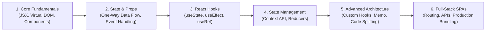

# ⚛️ React.js Mastery & Modern Frontend Laboratory

<div align="center">


[](https://react.dev)
[](https://vitejs.dev)
[](https://developer.mozilla.org/en-US/docs/Web/JavaScript)
[](LICENSE)

<br/>

**A structured, comprehensive journey through modern React.js development.**  
*From core JSX, props, and state mechanics to custom hooks, Context API, state management, and production-grade Vite SPA builds.*

[🚀 Quick Start](#-running-a-project-locally) • [📚 Roadmap & Concepts](#-learning-roadmap--topics) • [📦 Project Showcase](#-practice-projects--applications) • [🛠️ Architecture](#️-project-architecture)

---

</div>

## 📖 Overview

This repository documents an in-depth learning journey through **React.js** and modern component-driven frontend architecture. It moves step-by-step from foundational mental models (unidirectional data flow, declarative UI, component lifecycle) to advanced production patterns (custom hooks, memoization, Context state sharing, and performance tuning).

Every subfolder is a self-contained, runnable application powered by **Vite** or **Create React App**.

---

## 📚 Learning Roadmap & Topics



### Concept Checklist

- [x] **JSX & Component Architecture:** Functional components, fragment syntax, conditional rendering, list mapping with keys.
- [x] **Props & Component Communication:** Dynamic props, children props, prop destructuring, callback props for child-to-parent communication.
- [x] **State & Event Systems:** Reactive state with `useState`, handling complex forms, controlled vs. uncontrolled inputs.
- [x] **Lifecycle & Side Effects:** Asynchronous data fetching, subscription cleanups, and dependency arrays with `useEffect`.
- [x] **Global State Management:** Prop-drilling elimination using `createContext` and `useContext`.
- [x] **Performance & Optimization:** Reference preservation with `useMemo` and `useCallback`, avoiding unnecessary re-renders.
- [x] **Modern Build Tooling:** Fast HMR, Rollup bundling, and environment variable configuration via Vite.

---

## 📦 Practice Projects & Applications

The repository features multiple dedicated applications exploring different aspects of the React ecosystem:

| Project | Build System | Focus Areas & Features |
|:---|:---:|:---|
| **`block-project-react`** | Vite + React | Modern modular architecture, reusable card UI blocks, and stateful interactive widgets |
| **`react-app-2026`** | Vite + React | Latest React features, modern styling integrations, and modular component patterns |
| **`my-new-app`** | Vite + React | Experimental component sandboxes, dynamic event listeners, and API integration |
| **`react-tutorial-2023`** | React SPA | Foundational component exercises, props drilling exercises, and form handling |
| **`my-cra-app`** | Create React App | Traditional Webpack-based React boilerplate reference |

---

## 📁 Repository Structure

```plaintext
react-js/
├── block-project-react/      # Standalone interactive component practice app (Vite)
├── react-app-2026/           # Modern 2026 React project sandbox (Vite)
├── my-new-app/               # Feature testing and API experiment app (Vite)
├── react-tutorial-2023/      # Core tutorial exercises and milestone examples
├── my-cra-app/               # Create React App reference setup
├── .gitattributes            # Line ending configurations
└── README.md                 # Complete roadmap and documentation
```

---

## ⚡ Running a Project Locally

Each project directory is an independent Node.js application.

### 1. Clone the repository
```bash
git clone https://github.com/nahidzaman1996271-sketch/react-js.git
cd react-js
```

### 2. Choose a project and install dependencies
```bash
# Example: Running the modern Vite practice app
cd block-project-react

npm install
```

### 3. Start the development server
```bash
npm run dev
```
Open the provided local URL (typically `http://localhost:5173`) in your browser to experience instant Hot Module Replacement (HMR).

---

## 📄 License

This repository is licensed under the [MIT License](LICENSE).

---

<div align="center">
  <sub>Maintained by <a href="https://github.com/nahidzaman1996271-sketch">Nahid Zaman</a></sub>
</div>
